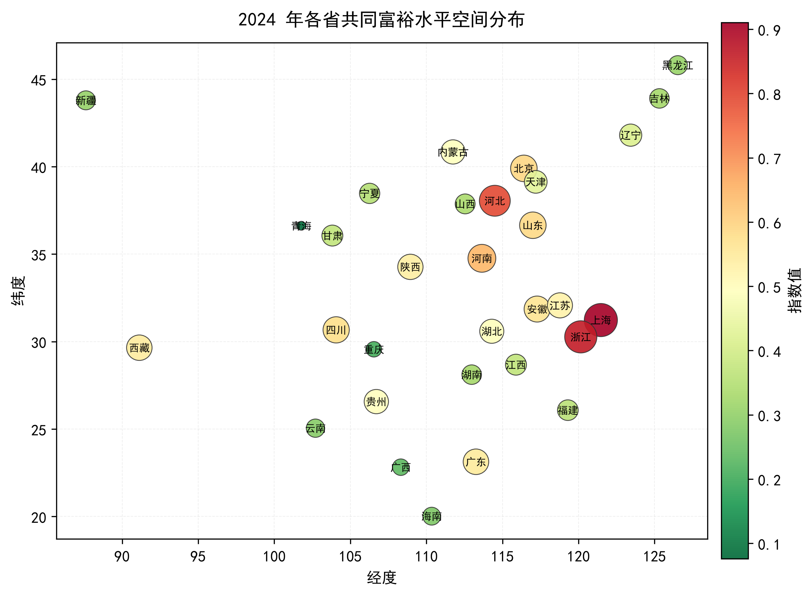
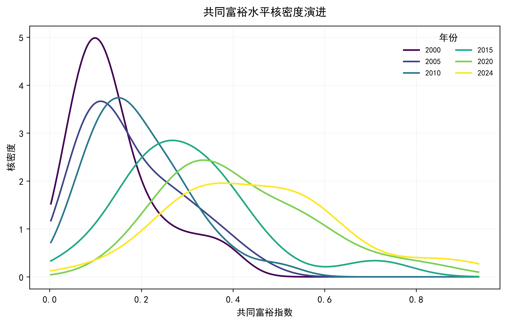
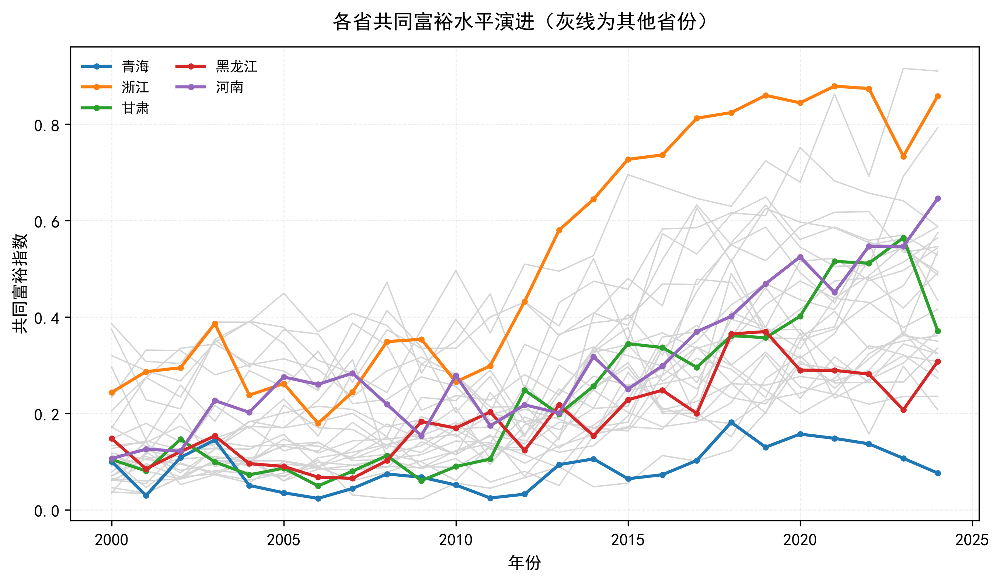
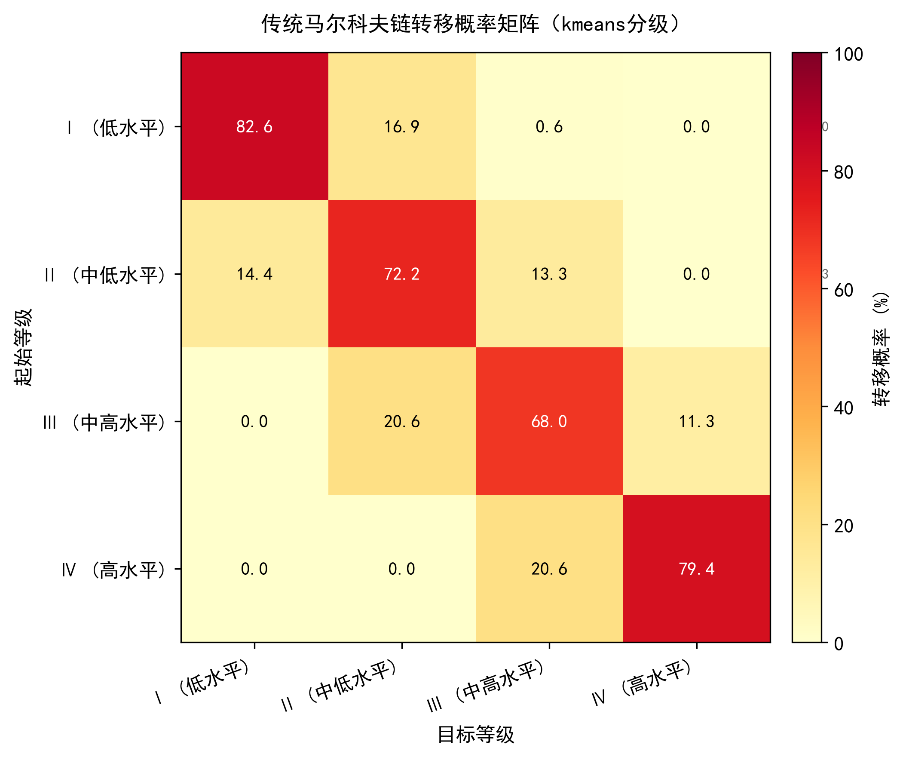

# Markov Chain Spatial Evolution

马尔科夫链动态演进分析框架：**传统马尔科夫链 + 空间马尔科夫链**，两套分级方式并列对比，五种空间权重矩阵可换。

面向区域经济、共同富裕、新质生产力这类「省域面板指数随时间演进」的测度研究。数据年份不限，换数据只改 `config.yaml` 一行路径。

```bash
python src/main.py        # 零参数直接跑（自带的模拟数据开箱可用）
```

---

## 一、跑出来是什么样

五类产出，49 张图 + 30 余张结果表 + 一段自动生成的结论文本。

| 空间格局 | 核密度演进 |
|---|---|
|  |  |

| 省份轨迹 | 传统转移矩阵（KMeans 分级） |
|---|---|
|  |  |

空间马尔科夫链还会按「邻居所处等级」分别输出 4 张矩阵（低/中低/中高/高水平邻居各一张），
每换一种权重矩阵就重出一组 —— 这是空间 MC 与传统 MC 的核心区别所在。

---

## 二、方法

### 2.1 等级划分：两套并存

| 方式 | 做法 | 什么时候用 |
|---|---|---|
| **四分位** `quartile` | 按分位点切 4 档，边界可设 pooled（全样本合并）或 yearly（逐年） | 复现文献、样本分布偏态明显时 |
| **KMeans** `kmeans` | 一维 KMeans++ 聚类切 4 档 | 样本分布有多峰时更贴合实际分层 |

两套结果**并列输出**，不是二选一 —— 结论若只在一种分级下成立，本身就是一个需要说明的稳健性问题。

### 2.2 传统马尔科夫链

在 `src/markov.py`，除转移矩阵外还做了四件容易被跳过的事：

- **稳态分布**：求解长期均衡下各等级的份额
- **期望持续时间**：每个等级平均停留几期
- **卡方独立性检验**：检验转移是否与起始等级独立
- **遍历性检查**：判定矩阵是否不可约、非周期（含 BFS 求环长判定非周期），不满足时稳态分布无意义

最后一项是很多实现直接省略的。省了就会在不满足遍历性的矩阵上照样报出一个「稳态分布」，
看起来有结果，实际没有意义。

### 2.3 空间马尔科夫链

四步：

1. 按权重矩阵算每个省份的**邻居加权均值**
2. 用邻居均值确定该省所处的「邻居等级」
3. 按邻居等级把转移样本分组
4. 每组单独估一个转移矩阵 —— 就是那 4 张矩阵

额外做了**溢出效应检验**（`spillover_test`）：比较某等级省份在「低水平邻居」与「高水平邻居」
下的转移概率差异是否显著，用来判断邻居是否真的影响了本地的转移方向，而不只是相关。

### 2.4 五种空间权重矩阵

| 名称 | 构造 | 说明 |
|---|---|---|
| `adjacency` | 0-1 邻接 | 有共同边界记 1 |
| `geographic` | 地理距离倒数 | 省域经纬度大圆距离 |
| `economic` | 经济距离倒数 | 用人均 GDP 等经济变量算差距 |
| `eco_geographic` | 经济地理嵌套 | 地理距离 × 经济差距的组合权重 |
| `custom` | 自定义 | 直接给 CSV 矩阵，`data/spatial_weight_custom.csv` 是模板 |

换矩阵只改 `config.yaml` 里 `spatial_weights.active` 一行。**同一份数据在五种矩阵下的结论若不一致，
本身就是研究结论的一部分** —— 说明空间关联的作用渠道是地理的还是经济的，不能被任意指定。

---

## 三、一个值得说的口径问题

我按韩建雨、葛汉琪《我国共同富裕水平测度、地区差异和动态演进》（统计与决策 2022 年第 23 期）
的方法框架实现时，在频数口径上停了一下。

论文表 4 报告的四档频数是 `109 / 109 / 97 / 88`（合计 403）。但把表里同一行的转移概率
与这组频数对回去，乘不出对应的小数 —— 那一列更像是「按省份最终等级统计的省份数」，
不是「按转移样本统计的转移次数」。

标准做法应该是：

```
N_ij = 同一个省份、相邻两期，从等级 i 转到等级 j 的次数
```

31 个省 × 24 个两期间隔（2000—2024）= 744 条有效转移。所以本实现产出的频数是长条形的，
各行样本数在 200 上下，**与论文表 4 的数字不会一致**。

这不是实现错误，是刻意选择了更规范的口径，并在 README 与代码注释里标注了差异来源。
复现文献时遇到「结果对不上」，先分清是方法不同还是口径不同 —— 这次是后者，且原文那一列大概率是笔误。

另有一处正常差异：论文样本期是 2007—2020（因 2007 年财政收支分类改革，保证口径可比），
本实现不限定年份。期间不同，等级边界与转移概率自然不同。

---

## 四、快速开始

```bash
# 环境
python -m venv .venv && .venv/bin/pip install -r requirements.txt
# Windows: .venv\Scripts\pip install -r requirements.txt

# 直接跑自带模拟数据
python src/main.py

# 换自己的数据：把文件放进 data/，改 config.yaml 的 data.file
```

数据支持四种形态，`shape: auto` 会自己判断：

| 形态 | 说明 |
|---|---|
| `raw` | 原始指标表，代码内部用**熵权-TOPSIS** 合成指数 |
| `long` | 长表，一行一个「省-年」，已有算好的指数 |
| `wide` | 宽表，行=年份、列=省份 |
| `wide_transposed` | 宽表转置，行=省份、列=年份 |

输出集中在 `output/`：`结果说明.txt`（结论文本）、`tables/`（明细表）、`figures/`（图）。

---

## 五、目录

```
├── config.yaml              所有可调项都在这里，不用改代码
├── requirements.txt
├── src/
│   ├── main.py              主流程（685 行）
│   ├── markov.py            传统 MC + 空间 MC + 检验（956 行）
│   ├── spatial_weights.py   五种权重矩阵（700 行）
│   ├── loader.py            四种数据形态识别与熵权-TOPSIS（670 行）
│   ├── classify.py          四分位 / KMeans 双分级（328 行）
│   ├── visualize.py         出图（347 行）
│   ├── utils.py             通用工具（237 行）
│   ├── province_data.py     省份经纬度等参照表（213 行）
│   └── make_test_data.py    模拟数据生成（190 行）
├── data/                    演示数据（模拟生成，非真实观测）
└── docs/figures/            示例输出图
```

代码共 4326 行。`output/` 未入库（运行产物，约 11MB）。

---

## 六、边界

- 只做马尔科夫链演进分析。文献里的 Dagum 基尼分解、空间收敛检验属于另外的方法，本仓库不含。
- `data/` 里是**模拟数据**，用于验证流程可跑通，数值不代表任何真实地区。
- 空间权重矩阵只给出构造方式，矩阵本身的选择需要研究设计来定，代码不做推荐。
